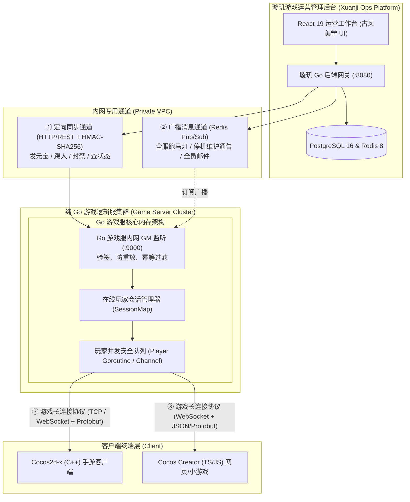

# 璇玑运营与GM平台 · 真实游戏服务器与 Cocos2d-x (C++/JS) 纯 Go 服务端接入技术指南

> **版本**：v2.0.0  
> **适用游戏架构**：
> - 客户端：Cocos2d-x (C++ / JS / TS)、Cocos Creator、Unity、UE 或原生微端
> - 服务端：纯 Go 状态化逻辑服（Goroutine / Actor 架构）或分布式游戏集群  
> **目标读者**：游戏服务端主程、Go 后端开发、Cocos 客户端开发、游戏运维

---

## 目录 (Table of Contents)
- [一、 整体架构拓扑与 Cocos2d-x + 纯 Go 解耦原理](#一-整体架构拓扑与-cocos2d-x--纯-go-解耦原理)
- [二、 为什么 Cocos2d-x 客户端完全零侵入](#二-为什么-cocos2d-x-客户端完全零侵入)
- [三、 璇玑后台与 Go 游戏服的 7 大标准 GM 接口契约](#三-璇玑后台与-go-游戏服的-7-大标准-gm-接口契约)
- [四、 安全鉴权、HMAC-SHA256 签名与防重放幂等机制](#四-安全鉴权hmac-sha256-签名与防重放幂等机制)
- [五、 纯 Go 游戏逻辑服接入端完整代码范例](#五-纯-go-游戏逻辑服接入端完整代码范例)
- [六、 Cocos2d-x 客户端消息接收范例 (C++ & JS/TS)](#六-cocos2d-x-客户端消息接收范例-c--jsts)
- [七、 璇玑后台环境变量配置 (.env) 与多区服路由](#七-璇玑后台环境变量配置-env-与多区服路由)
- [八、 在线/离线数据同步、充值流水与游戏日志汇总](#八-在线离线数据同步充值流水与游戏日志汇总)
- [九、 端到端连通性测试与排错自检 (Ping API)](#九-端到端连通性测试与排错自检-ping-api)
- [十、 跨平台一键启动脚本 (Windows & Linux 无脚本/带脚本完整代码)](#十-跨平台一键启动脚本-windows--linux-无脚本带脚本完整代码)

---

## 一、 整体架构拓扑与 Cocos2d-x + 纯 Go 解耦原理

在商业级网络游戏中，Cocos2d-x 客户端（无论是使用 C++ 原生渲染还是 Cocos Creator 的 JS/TS 脚本）通常与纯 Go 编写的高并发游戏逻辑服保持**长连接**（TCP、KCP 或 WebSocket），协议通常采用 Protobuf 或自定义紧凑二进制流。

璇玑运营平台与游戏集群采用**双通道完全解耦架构**：
- **运营控制层**：璇玑后台通过内网 HTTP REST / Webhook 或 Redis 消息总线与 Go 游戏服务器的 GM 运维管理端交互。
- **游戏逻辑层**：Go 游戏服作为控制中枢，在玩家专属协程（Goroutine/Actor）中执行数值变动，并将结果封装为游戏原生网络包推给 Cocos 客户端。



---

## 二、 为什么 Cocos2d-x 客户端完全零侵入

1. **不需要嵌入任何运营 SDK**：
   Cocos2d-x 客户端内部只保留正常的游戏业务长连接逻辑。所有的 GM 指令、道具到账、封禁踢人，对客户端来说都只是一条普通的 **S2C（Server to Client）业务协议包**。
2. **规避直接修改数据库的安全隐患**：
   在线玩家的核心数值均常驻在 Go 游戏服的内存中。运营人员在后台点击“发放元宝”时，璇玑命令 Go 游戏服通过安全 Channel 派发给玩家协程，修改内存并触发回盘，绝对不会发生数据竞态（Data Race）或内存覆盖回滚。

---

## 三、 璇玑后台与 Go 游戏服的 7 大标准 GM 接口契约

璇玑后台内置的 [`HttpDriver`](file:///home/boyunxi/code/xuanji/backend/internal/gameserver/http_driver.go) 在触发操作时，会自动向 Go 游戏服发起标准 POST 请求。

### 1. 接口列表清单

| 接口路由 (Path) | 请求方式 | 关键请求载荷 (JSON) | 功能说明 |
| :--- | :--- | :--- | :--- |
| `/api/gm/ping` | `GET` | 无 | 心跳检测，返回节点状态与延迟 |
| `/api/gm/item/send` | `POST` | `requestId`, `game`, `playerId`, `itemId`, `amount`, `reason` | 在线玩家道具/货币实时注入 |
| `/api/gm/player/kick` | `POST` | `requestId`, `game`, `playerId`, `reason` | 强制切断玩家 TCP/WS 连接踢下线 |
| `/api/gm/player/status` | `POST` | `requestId`, `game`, `playerId`, `status`, `reason` | 封禁账号 (`status="已封禁"`) 或解除封禁 |
| `/api/gm/broadcast` | `POST` | `requestId`, `game`, `content`, `priority` | 全服滚动跑马灯公告广播 |
| `/api/gm/mail/send` | `POST` | `requestId`, `game`, `mailId`, `title`, `content`, `targetType`, `attachments` | 系统信件与带附件补偿邮件派发 |
| `/api/gm/command` | `POST` | `requestId`, `game`, `command`, `target`, `params` | 自定义 GM 指令控制台执行 |

### 2. 标准响应契约 (Response Envelope)

Go 游戏服处理完毕后，按如下统一格式返回 HTTP 200：

```json
{
  "code": 0,
  "message": "操作执行成功"
}
```

- 若 `code == 0`：后台判定操作成功，前端弹出古风通知提示。
- 若 `code != 0`：后台判定失败，直接将 `message` 中的业务报错原因展示给管理员（例如：`"玩家背包格数不足"` 或 `"目标玩家不在此逻辑服"`）。

---

## 四、 安全鉴权、HMAC-SHA256 签名与防重放幂等机制

由于 GM 接口具备最高管理权限，璇玑在每次调用时均强制携带身份凭据。推荐在生产环境采用 **HMAC-SHA256 动态签名机制**：

### 1. 签名计算规范
每次 HTTP 请求均包含两个自定义 Header：
- `X-Timestamp`: 发起请求的 Unix 秒级时间戳（例如 `1792600200`）。
- `X-Signature`: 签名散列十六进制字符串。

签名计算公式：
$$\text{Signature} = \text{Hex}(\text{HMAC-SHA256}(\text{SecretKey}, \text{Timestamp} + \text{"\n"} + \text{RequestBody}))$$

### 2. 防重放与幂等防刷
Go 游戏服在收到请求时应执行两道防御：
1. **时间戳防重放**：若 `|time.Now().Unix() - timestamp| > 300` 秒（5分钟），直接拒绝处理。
2. **RequestId 分布式锁**：利用 Redis 执行 `SETNX gm:lock:{requestId} 1 EX 600`。若 Key 已存在，直接返回 `code: 409`（指令已受理，严防重复到账）。

---

## 五、 纯 Go 游戏逻辑服接入端完整代码范例

以下是一个完整、可直接粘贴到独立 Go 游戏服工程中的 `gm_gateway.go` 实现。它示范了如何监听 GM 端口、校验 HMAC 签名、派发内存任务并向 Cocos 长连接发送通知：

```go
package main

import (
	"crypto/hmac"
	"crypto/sha256"
	"encoding/hex"
	"encoding/json"
	"fmt"
	"io"
	"log"
	"math"
	"net/http"
	"strconv"
	"sync"
	"time"
)

// ---------------- 1. 游戏服核心内存模型 ----------------

type CocosSession struct {
	PlayerID   string
	PlayerName string
	Yuanbao    int64
	// 向 Cocos2d-x 客户端发送二进制/Protobuf/JSON 消息的钩子
	SendToCocos func(cmdID int, payload []byte)
	// 强制断开客户端 Socket
	KickSocket func(reason string)
	// 协程安全任务通道 (单协程串行处理，防止多线程并发破坏内存)
	TaskQueue chan func()
}

type OnlineManager struct {
	mu       sync.RWMutex
	sessions map[string]*CocosSession
}

var globalOnlineMgr = &OnlineManager{
	sessions: make(map[string]*CocosSession),
}

func (m *OnlineManager) Get(playerID string) *CocosSession {
	m.mu.RLock()
	defer m.mu.RUnlock()
	return m.sessions[playerID]
}

// ---------------- 2. GM 网关服务实现 ----------------

type GMService struct {
	SecretKey string
}

// HMAC 签名与防重放拦截
func (s *GMService) verifyAuth(r *http.Request, body []byte) error {
	tsStr := r.Header.Get("X-Timestamp")
	signature := r.Header.Get("X-Signature")
	if tsStr == "" || signature == "" {
		return fmt.Errorf("缺失鉴权头部 (X-Timestamp 或 X-Signature)")
	}

	ts, err := strconv.ParseInt(tsStr, 10, 64)
	if err != nil || math.Abs(float64(time.Now().Unix()-ts)) > 300 {
		return fmt.Errorf("请求时间戳已超时失效")
	}

	mac := hmac.New(sha256.New, []byte(s.SecretKey))
	mac.Write([]byte(tsStr + "\n" + string(body)))
	expectedSign := hex.EncodeToString(mac.Sum(nil))

	if !hmac.Equal([]byte(expectedSign), []byte(signature)) {
		return fmt.Errorf("签名验证未通过，密钥不匹配")
	}
	return nil
}

// 挂载路由
func StartGMHttpGateway(port int, secretKey string) {
	gm := &GMService{SecretKey: secretKey}
	mux := http.NewServeMux()

	// 1. 心跳检测接口
	mux.HandleFunc("GET /api/gm/ping", func(w http.ResponseWriter, r *http.Request) {
		w.Header().Set("Content-Type", "application/json")
		_ = json.NewEncoder(w).Encode(map[string]interface{}{
			"code":    0,
			"message": "纯 Go 游戏服连接畅通",
		})
	})

	// 2. 发送道具/元宝接口 (通知 Cocos 弹窗)
	mux.HandleFunc("POST /api/gm/item/send", func(w http.ResponseWriter, r *http.Request) {
		body, _ := io.ReadAll(r.Body)
		if err := gm.verifyAuth(r, body); err != nil {
			http.Error(w, err.Error(), http.StatusUnauthorized)
			return
		}

		var req struct {
			RequestID string `json:"requestId"`
			PlayerID  string `json:"playerId"`
			ItemName  string `json:"itemName"`
			Amount    int    `json:"amount"`
			Reason    string `json:"reason"`
		}
		_ = json.Unmarshal(body, &req)

		session := globalOnlineMgr.Get(req.PlayerID)
		if session == nil {
			// 玩家不在线时，返回友好提示或直接存入离线待领信箱
			w.Header().Set("Content-Type", "application/json")
			_ = json.NewEncoder(w).Encode(map[string]interface{}{
				"code":    0,
				"message": "玩家当前离线，物资已转入离线补偿队列，上线自动发放",
			})
			return
		}

		// 派发进玩家所属 Goroutine 执行修改
		done := make(chan struct{})
		session.TaskQueue <- func() {
			defer close(done)
			session.Yuanbao += int64(req.Amount)

			// 组装发给 Cocos2d-x 客户端的协议包 (例如命令字 2001: CMD_RECHARGE_NOTIFY)
			notifyPacket, _ := json.Marshal(map[string]interface{}{
				"event":   "ADD_ITEM",
				"item":    req.ItemName,
				"amount":  req.Amount,
				"balance": session.Yuanbao,
				"reason":  req.Reason,
			})
			session.SendToCocos(2001, notifyPacket)
			log.Printf("[GM] 玩家 %s 成功增加 %s x%d", session.PlayerID, req.ItemName, req.Amount)
		}
		<-done

		w.Header().Set("Content-Type", "application/json")
		_ = json.NewEncoder(w).Encode(map[string]interface{}{
			"code":    0,
			"message": "元宝道具已成功注入在线玩家背包并刷新客户端",
		})
	})

	// 3. 踢玩家下线接口
	mux.HandleFunc("POST /api/gm/player/kick", func(w http.ResponseWriter, r *http.Request) {
		body, _ := io.ReadAll(r.Body)
		if err := gm.verifyAuth(r, body); err != nil {
			http.Error(w, err.Error(), http.StatusUnauthorized)
			return
		}

		var req struct {
			PlayerID string `json:"playerId"`
			Reason   string `json:"reason"`
		}
		_ = json.Unmarshal(body, &req)

		if session := globalOnlineMgr.Get(req.PlayerID); session != nil {
			session.KickSocket(req.Reason)
		}

		w.Header().Set("Content-Type", "application/json")
		_ = json.NewEncoder(w).Encode(map[string]interface{}{
			"code":    0,
			"message": "已向客户端发送强制断线指令",
		})
	})

	log.Printf("🎮 游戏服 GM 运维网关已在 :%d 成功启动", port)
	_ = http.ListenAndServe(fmt.Sprintf("0.0.0.0:%d", port), mux)
}
```

---

## 六、 Cocos2d-x 客户端消息接收范例 (C++ & JS/TS)

当 Go 游戏服收到璇玑的 GM 指令并推给长连接后，Cocos 客户端按常规协议监听即可：

### 1. Cocos2d-x C++ 实现范例 (`NetworkDispatcher.cpp`)

```cpp
#include "cocos2d.h"
#include "NetworkManager.h"
#include "ui/CocosGUI.h"

USING_NS_CC;

void NetworkDispatcher::onMessageReceived(int cmdID, const std::string& jsonData)
{
    switch (cmdID) {
        // 收到 GM 补发道具/充值通知
        case 2001: {
            rapidjson::Document doc;
            doc.Parse(jsonData.c_str());
            if (!doc.HasParseError()) {
                std::string item = doc["item"].GetString();
                int amount = doc["amount"].GetInt();
                
                // 调度到主渲染线程弹出飘字动效
                Director::getInstance()->getScheduler()->performFunctionInCocosThread([item, amount]() {
                    auto label = Label::createWithTTF(
                        StringUtils::format("收到运营补偿: %s x%d", item.c_str(), amount),
                        "fonts/arial.ttf", 24);
                    label->setColor(Color3B::YELLOW);
                    label->setPosition(Vec2(VisibleRect::center().x, VisibleRect::center().y + 50));
                    Director::getInstance()->getRunningScene()->addChild(label, 999);
                    
                    // 向上飘动并渐隐
                    label->runAction(Sequence::create(
                        Spawn::create(MoveBy::create(1.5f, Vec2(0, 100)), FadeOut::create(1.5f), nullptr),
                        RemoveSelf::create(),
                        nullptr
                    ));
                });
            }
            break;
        }

        // 收到强制踢下线通知
        case 1002: {
            Director::getInstance()->getScheduler()->performFunctionInCocosThread([]() {
                // 弹出模态弹窗后退回登录场景
                Director::getInstance()->replaceScene(LoginScene::createScene());
            });
            break;
        }
    }
}
```

### 2. Cocos Creator (TypeScript / JavaScript) 实现范例 (`NetHandler.ts`)

```typescript
import { _decorator, Component, director, Label, instantiate, Prefab } from 'cc';
const { ccclass, property } = _decorator;

@ccclass('NetHandler')
export class NetHandler extends Component {
    @property(Prefab)
    public toastPrefab: Prefab | null = null;

    onLoad() {
        // 监听来自 Go 服务端的 WebSocket 事件
        window.gameSocket.on('message', (cmdId: number, data: any) => {
            switch (cmdId) {
                case 2001: // 道具到账
                    this.showItemRewardToast(data.item, data.amount);
                    break;
                case 1002: // 账号封禁或强制下线
                    alert(`系统提示: ${data.reason || '您的账号已被管理员下线'}`);
                    director.loadScene('LoginScene');
                    break;
                case 3001: // 全服跑马灯
                    this.showMarqueeText(data.content);
                    break;
            }
        });
    }

    private showItemRewardToast(itemName: string, count: number) {
        console.log(`恭喜道友，运营福利已到账: ${itemName} x${count}`);
        // 播放飞金币、刷新背包 UI 组件
    }

    private showMarqueeText(text: string) {
        // 在顶部跑马灯横幅节点滚动字幕
    }
}
```

---

## 七、 璇玑后台环境变量配置 (.env) 与多区服路由

在璇玑后台根目录的 `.env` 文件中，仅需配置以下参数即可激活与真实 Go 游戏服的无缝联通：

```ini
# ==============================================================================
#  游戏服务器接入网关配置 (Game Server Gateway Config)
# ==============================================================================
# 驱动模式: http (单节点REST) | hybrid (HTTP定向操作 + Redis广播)
GAME_SERVER_DRIVER=http

# 默认游戏服 HTTP 基础接口网关
GAME_SERVER_HTTP_URL=http://127.0.0.1:9000

# 鉴权机制: hmac_sha256 (推荐生产环境) | bearer | header | none
GAME_SERVER_AUTH_TYPE=hmac_sha256
GAME_SERVER_SECRET=xuanji_cocos_go_secret_2026

# 多区服分流路由 (JSON 字典映射: 区服名称 -> 真实 Go 物理服网关)
GAME_SERVER_SERVERS_JSON={"山海长歌":"http://10.0.1.11:9000","九州志":"http://10.0.1.12:9000","云间录":"http://10.0.1.13:9000"}
```

---

## 八、 在线/离线数据同步、充值流水与游戏日志汇总

除了指令下发，真实业务的数据如何汇入运营后台：

1. **玩家基本资料同步**：
   - 玩家进入游戏创建角色或下线存档时，Go 游戏服可直接异步写入 PostgreSQL 的 `players` 表，更新等级、战力、最后登入时间与充值累计。
2. **行为与消耗流水日志 (Game Logs)**：
   - 游戏内的产销流水（如道具丢弃、装备强化、元宝抽取）直接写入 PostgreSQL `game_logs` 表，后台日志模块即可实时根据区服、日志类型、玩家 ID 进行秒级检索。
3. **充值到账回调**：
   - 充值订单走通支付网关后，写入 `orders` 表，并通过 `/api/gm/item/send` 即时将购买的元宝或礼包推入 Go 游戏服内存。

---

## 九、 端到端连通性测试与排错自检 (Ping API)

完成上述配置与 Go 游戏服启动后，可直接调用后台自检接口验证网络连通性：

```bash
# 测试与“山海长歌”区服真实节点的连通性
curl -X POST http://localhost:8080/api/gameserver/ping \
  -H "Authorization: Bearer <ADMIN_TOKEN>" \
  -H "Content-Type: application/json" \
  -d '{"game": "山海长歌"}'
```

**成功返回示例**：
```json
{
  "success": true,
  "latencyMs": 5,
  "serverName": "http://10.0.1.11:9000",
  "message": "纯 Go 游戏服连接畅通",
  "driver": "http"
}
```

---

## 十、 跨平台一键启动脚本 (Windows & Linux 无脚本/带脚本完整代码)

为避免不同操作系统（尤其是 Windows 与 Linux）之间的换行符与环境兼容问题，**本项目仓库不跟踪上传 `.sh` 文件**。开发者可直接从下方代码块中复制适合自身系统的启动脚本或直接运行分步命令。

---

### 1. Windows 原生批处理脚本 (`start.bat`)
在项目根目录下新建 `start.bat`，粘贴以下内容即可双击或在 CMD 运行：

```bat
@echo off
chcp 65001 >nul
setlocal enabledelayedexpansion

echo =====================================================
echo         璇 玑 · 游 戏 运 营 后 台 (Xuanji Operations)
echo         React 19 + Go 1.26 全栈一键启动 [Windows]
echo =====================================================

set "ROOT_DIR=%~dp0"
set "BACKEND_DIR=%ROOT_DIR%backend"
set "FRONTEND_DIR=%ROOT_DIR%frontend"

:: 检查前端 dist 是否已构建
if not exist "%FRONTEND_DIR%\dist\index.html" (
    echo ▶ 检测到前端静态文件尚未构建，正在执行打包...
    cd /d "%FRONTEND_DIR%"
    call pnpm build
    if errorlevel 1 (
        echo ❌ 前端打包失败，请检查 pnpm 环境
        pause
        exit /b 1
    )
    echo ✔ 前端构建完成
)

:: 编译 Go 后端二进制
echo ▶ 编译 Go 后端服务...
cd /d "%BACKEND_DIR%"
go build -o "%BACKEND_DIR%\bin\server.exe" ./cmd/server
if errorlevel 1 (
    echo ❌ Go 编译失败，请确认已安装 Go 1.22+ 且环境变量就绪
    pause
    exit /b 1
)
echo ✔ Go 后端编译成功

:: 启动全栈统一服务
set "STATIC_DIR=%FRONTEND_DIR%\dist"
echo.
echo =====================================================
echo  ✔ 统一访问地址: http://localhost:8080
echo  ✔ 默认登录账号: admin / xuanji2026
echo  (按 Ctrl+C 可停止后台服务)
echo =====================================================
echo.

"%BACKEND_DIR%\bin\server.exe"
pause
```

---

### 2. Windows PowerShell 高级脚本 (`start.ps1`)
在 PowerShell 终端中执行（支持多端口检查与开发模式）：

```powershell
<#
.SYNOPSIS
    璇玑运营后台 Windows PowerShell 启动器
.EXAMPLE
    .\start.ps1        # 生产全栈统一托管模式 (端口 8080)
    .\start.ps1 -Dev   # 开发热重载模式 (前端 5173 + 后端 8080)
#>
param (
    [switch]$Dev
)

$ErrorActionPreference = "Stop"
$RootDir = Split-Path -Parent $MyInvocation.MyCommand.Path
$BackendDir = Join-Path $RootDir "backend"
$FrontendDir = Join-Path $RootDir "frontend"

Write-Host "=====================================================" -ForegroundColor DarkGreen
Write-Host "     璇 玑 · 游 戏 运 营 后 台 (Xuanji Operations)     " -ForegroundColor Cyan
Write-Host "=====================================================" -ForegroundColor DarkGreen

# 检查端口占用并安全清理
function Free-Port([int]$port) {
    $conns = Get-NetTCPConnection -LocalPort $port -ErrorAction SilentlyContinue
    if ($conns) {
        $pids = $conns.OwningProcess | Select-Object -Unique
        Write-Host "▶ 正在释放端口 :$port (PID: $pids)..." -ForegroundColor Yellow
        foreach ($pidToKill in $pids) {
            Stop-Process -Id $pidToKill -Force -ErrorAction SilentlyContinue
        }
    }
}

Free-Port 8080

if ($Dev) {
    Free-Port 5173
    Write-Host "▶ 启动模式: [开发联调模式]" -ForegroundColor Green
    
    # 后台启动 Go API
    Set-Location $BackendDir
    go build -o "$BackendDir\bin\server.exe" ./cmd/server
    $backendProc = Start-Process -FilePath "$BackendDir\bin\server.exe" -PassThru -NoNewWindow
    
    # 启动 Vite 前端
    Set-Location $FrontendDir
    Write-Host "✔ 访问开发地址: http://localhost:5173" -ForegroundColor Cyan
    pnpm dev
} else {
    Write-Host "▶ 启动模式: [全栈统一服务]" -ForegroundColor Green
    if (-not (Test-Path "$FrontendDir\dist\index.html")) {
        Write-Host "▶ 首次运行，正在构建前端静态资源..." -ForegroundColor Yellow
        Set-Location $FrontendDir
        pnpm build
    }
    
    Set-Location $BackendDir
    go build -o "$BackendDir\bin\server.exe" ./cmd/server
    $env:STATIC_DIR = "$FrontendDir\dist"
    
    Write-Host "`n✔ 访问控制台: http://localhost:8080" -ForegroundColor Cyan
    Write-Host "✔ 登录凭据: admin / xuanji2026`n" -ForegroundColor Gray
    & "$BackendDir\bin\server.exe"
}
```

---

### 3. Linux / macOS 原生 Bash 脚本 (`start.sh`)
在 Linux / WSL 环境下可创建 `start.sh`（或直接使用命令行执行）：

```bash
#!/usr/bin/env bash
set -e

ROOT_DIR="$(cd "$(dirname "${BASH_SOURCE[0]}")" && pwd)"
BACKEND_DIR="$ROOT_DIR/backend"
FRONTEND_DIR="$ROOT_DIR/frontend"

# 释放可能被占用的端口
release_port() {
  local port="$1"
  local pids=$(lsof -ti :"$port" 2>/dev/null || fuser "$port/tcp" 2>/dev/null || true)
  if [ -n "$pids" ]; then
    kill -9 $pids 2>/dev/null || true
  fi
}

release_port 8080

# 编译 Go 后端
echo "▶ 编译 Go 后端服务..."
cd "$BACKEND_DIR"
go build -o "$BACKEND_DIR/bin/server" ./cmd/server

# 构建前端 (若未打包)
if [ ! -f "$FRONTEND_DIR/dist/index.html" ]; then
  echo "▶ 构建前端资源..."
  cd "$FRONTEND_DIR"
  pnpm build
fi

cd "$BACKEND_DIR"
export STATIC_DIR="$FRONTEND_DIR/dist"
echo ""
echo "✔ 统一控制台访问入口: http://localhost:8080"
echo "✔ 默认账号: admin  密码: xuanji2026"
echo ""
./bin/server
```

---

### 4. 纯命令行手动分步启动（零脚本，跨全平台）

如果不希望创建任何脚本文件，在任意操作系统（Windows CMD / PowerShell / macOS / Linux）终端中，依次执行以下命令即可：

```bash
# 步骤 1：构建前端静态页面
cd frontend
pnpm install
pnpm build
cd ..

# 步骤 2：启动 Go 后端并托管前端页面
cd backend
go run cmd/server/main.go
```

启动完毕后，直接在浏览器中打开 **`http://localhost:8080`**，输入默认账号 `admin` / `xuanji2026` 即可立即进入古风运营后台管理系统。
